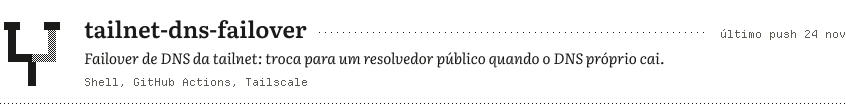
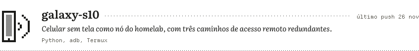
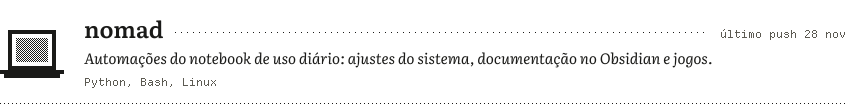
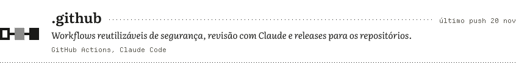

<!-- Arquivo gerado por tools/build.py a partir de tools/content.json. Não edite à mão: edite o JSON e rode `uv run tools/build.py readme`. -->

<picture>
  <source media="(max-width: 767px) and (prefers-color-scheme: dark)" srcset="https://raw.githubusercontent.com/brno01/brno01/output/hero-mobile-dark.svg">
  <source media="(max-width: 767px)" srcset="https://raw.githubusercontent.com/brno01/brno01/output/hero-mobile-light.svg">
  <source media="(prefers-color-scheme: dark)" srcset="https://raw.githubusercontent.com/brno01/brno01/output/hero-desktop-dark.svg">
  
</picture>

Desenvolvedor back-end com foco em automação e infraestrutura: Linux, homelab como código, CI/CD e integrações em Python e TypeScript.

<a href="https://www.linkedin.com/in/brno01oliveira/"><kbd><picture><source media="(prefers-color-scheme: dark)" srcset="https://raw.githubusercontent.com/brno01/brno01/output/icon-linkedin-dark.svg"></picture> LinkedIn</kbd></a> <a href="https://github.com/brno01?tab=repositories"><kbd><picture><source media="(prefers-color-scheme: dark)" srcset="https://raw.githubusercontent.com/brno01/brno01/output/icon-github-dark.svg"></picture> Repositórios</kbd></a> <a href="mailto:contato.bruno0dev@gmail.com"><kbd><picture><source media="(prefers-color-scheme: dark)" srcset="https://raw.githubusercontent.com/brno01/brno01/output/icon-gmail-dark.svg"></picture> E-mail</kbd></a> <a href="https://discord.gg/nQEaSHMcnp"><kbd><picture><source media="(prefers-color-scheme: dark)" srcset="https://raw.githubusercontent.com/brno01/brno01/output/icon-discord-dark.svg"></picture> Discord</kbd></a>

## Sobre

Trabalho com suporte técnico N2 e estou migrando para desenvolvimento. Fora do expediente, mantenho um homelab tratado como produção: tudo versionado, instalado por script, com testes, CI de segurança em cada push e revisão antes do merge.

Gosto de problemas que juntam código e sistema: servidores, redes, automações e as ferramentas que deixam tudo isso fácil de operar.

## Projetos

<a href="https://github.com/brno01/kindle-monitor">
<picture>
  <source media="(max-width: 767px) and (prefers-color-scheme: dark)" srcset="https://raw.githubusercontent.com/brno01/brno01/output/proj-kindle-monitor-mobile-dark.svg">
  <source media="(max-width: 767px)" srcset="https://raw.githubusercontent.com/brno01/brno01/output/proj-kindle-monitor-mobile-light.svg">
  <source media="(prefers-color-scheme: dark)" srcset="https://raw.githubusercontent.com/brno01/brno01/output/proj-kindle-monitor-desktop-dark.svg">
  
</picture>
</a>
<a href="https://github.com/brno01/sinapses">
<picture>
  <source media="(max-width: 767px) and (prefers-color-scheme: dark)" srcset="https://raw.githubusercontent.com/brno01/brno01/output/proj-sinapses-mobile-dark.svg">
  <source media="(max-width: 767px)" srcset="https://raw.githubusercontent.com/brno01/brno01/output/proj-sinapses-mobile-light.svg">
  <source media="(prefers-color-scheme: dark)" srcset="https://raw.githubusercontent.com/brno01/brno01/output/proj-sinapses-desktop-dark.svg">
  
</picture>
</a>
<a href="https://github.com/brno01/tailnet-dns-failover">
<picture>
  <source media="(max-width: 767px) and (prefers-color-scheme: dark)" srcset="https://raw.githubusercontent.com/brno01/brno01/output/proj-tailnet-dns-failover-mobile-dark.svg">
  <source media="(max-width: 767px)" srcset="https://raw.githubusercontent.com/brno01/brno01/output/proj-tailnet-dns-failover-mobile-light.svg">
  <source media="(prefers-color-scheme: dark)" srcset="https://raw.githubusercontent.com/brno01/brno01/output/proj-tailnet-dns-failover-desktop-dark.svg">
  
</picture>
</a>
<a href="https://github.com/brno01/galaxy-s10">
<picture>
  <source media="(max-width: 767px) and (prefers-color-scheme: dark)" srcset="https://raw.githubusercontent.com/brno01/brno01/output/proj-galaxy-s10-mobile-dark.svg">
  <source media="(max-width: 767px)" srcset="https://raw.githubusercontent.com/brno01/brno01/output/proj-galaxy-s10-mobile-light.svg">
  <source media="(prefers-color-scheme: dark)" srcset="https://raw.githubusercontent.com/brno01/brno01/output/proj-galaxy-s10-desktop-dark.svg">
  
</picture>
</a>
<a href="https://github.com/brno01/nomad">
<picture>
  <source media="(max-width: 767px) and (prefers-color-scheme: dark)" srcset="https://raw.githubusercontent.com/brno01/brno01/output/proj-nomad-mobile-dark.svg">
  <source media="(max-width: 767px)" srcset="https://raw.githubusercontent.com/brno01/brno01/output/proj-nomad-mobile-light.svg">
  <source media="(prefers-color-scheme: dark)" srcset="https://raw.githubusercontent.com/brno01/brno01/output/proj-nomad-desktop-dark.svg">
  
</picture>
</a>
<a href="https://github.com/brno01/.github">
<picture>
  <source media="(max-width: 767px) and (prefers-color-scheme: dark)" srcset="https://raw.githubusercontent.com/brno01/brno01/output/proj-dot-github-mobile-dark.svg">
  <source media="(max-width: 767px)" srcset="https://raw.githubusercontent.com/brno01/brno01/output/proj-dot-github-mobile-light.svg">
  <source media="(prefers-color-scheme: dark)" srcset="https://raw.githubusercontent.com/brno01/brno01/output/proj-dot-github-desktop-dark.svg">
  
</picture>
</a>

<b>Detalhes dos projetos</b>

- **[kindle-monitor](https://github.com/brno01/kindle-monitor)**: Um Kindle Paperwhite 5 com jailbreak mostra em e-ink CPU, RAM, GPU, temperaturas, discos e o estado dos serviços do homelab. O servidor coleta os dados e desenha a tela; o Kindle só busca a imagem pela rede privada e a exibe, e volta sozinho depois de reiniciar. O pacote do aparelho sai como release a cada versão.
- **[sinapses](https://github.com/brno01/sinapses)**: Biblioteca em TypeScript que desenha, em canvas, feixes de fios com física própria entre os nós de uma interface. O movimento mostra o estado de cada ligação: repouso, em uso, testando, atualizando, anomalia, quebrada, bloqueada, ligando e desligando. Roda num Web Worker com OffscreenCanvas quando o navegador permite, tem componente React, respeita a preferência por menos movimento e é publicada como pacote a cada versão.
- **[tailnet-dns-failover](https://github.com/brno01/tailnet-dns-failover)**: Workflow agendado no GitHub Actions que, a cada 5 minutos, entra na tailnet do Tailscale como nó efêmero e testa o servidor de DNS próprio. Se ele não responde, troca os nameservers da tailnet para um resolvedor público e volta quando o serviço se recupera; um resultado inconclusivo não muda nada. Como roda fora de casa, continua funcionando quando a rede local inteira cai. A credencial é um cliente OAuth com os escopos mínimos.
- **[galaxy-s10](https://github.com/brno01/galaxy-s10)**: Um Galaxy S10 com a tela quebrada vira um nó do homelab, ligado por USB ao servidor. Três caminhos independentes dão tela e toque remotos: adb por USB através de um túnel SSH, adb sem fio e VNC pela tailnet. Um guardião em Python, sem privilégios de root, confere o aparelho a cada 30 segundos e só corrige o que saiu do lugar. O celular também serve para testar apps Android a distância.
- **[nomad](https://github.com/brno01/nomad)**: Os scripts que configuram e mantêm o notebook de uso diário, versionados: instaladores idempotentes com modo de simulação e desfazer, um exportador que documenta a máquina no Obsidian e um vigia que mantém o cofre organizado, e o perfil de streaming de jogos para o celular. Testes com bats e pytest e a mesma varredura de segurança dos outros repositórios.
- **[.github](https://github.com/brno01/.github)**: Configuração compartilhada da conta. Um workflow de segurança roda gitleaks, osv-scanner, semgrep, shellcheck, actionlint e zizmor e abre uma issue quando a branch principal falha; outro traz a revisão sob demanda com o Claude, acionada só pelo dono; um terceiro cria a release de cada tag. Cada repositório copia um arquivo pequeno e usa a versão v1; as ferramentas são baixadas em versões fixas e conferidas por SHA-256.

**Também construí (privados)**

- Homelab como código: contêineres, stack de IA local, servidores de jogo, backups e os scripts que instalam e vigiam tudo.
- App desktop modular em React e Tauri/Rust para ferramentas internas, com autenticação central e execução de integrações auditada.

**Estudos:** [e-Fispq](https://github.com/brno01/e-Fispq) (API em NestJS), [estudo-rest-api-js](https://github.com/brno01/estudo-rest-api-js) (API REST em Express), [app-estudo](https://github.com/brno01/app-estudo) (API REST em Express)

## Stack

**Linguagens** 
<kbd><picture><source media="(prefers-color-scheme: dark)" srcset="https://raw.githubusercontent.com/brno01/brno01/output/icon-python-dark.svg"></picture> Python</kbd> <kbd><picture><source media="(prefers-color-scheme: dark)" srcset="https://raw.githubusercontent.com/brno01/brno01/output/icon-typescript-dark.svg"></picture> TypeScript</kbd> <kbd><picture><source media="(prefers-color-scheme: dark)" srcset="https://raw.githubusercontent.com/brno01/brno01/output/icon-javascript-dark.svg"></picture> JavaScript</kbd> <kbd><picture><source media="(prefers-color-scheme: dark)" srcset="https://raw.githubusercontent.com/brno01/brno01/output/icon-gnubash-dark.svg"></picture> Bash</kbd> <kbd><picture><source media="(prefers-color-scheme: dark)" srcset="https://raw.githubusercontent.com/brno01/brno01/output/icon-rust-dark.svg"></picture> Rust</kbd>

**Back-end** 
<kbd><picture><source media="(prefers-color-scheme: dark)" srcset="https://raw.githubusercontent.com/brno01/brno01/output/icon-nodedotjs-dark.svg"></picture> Node.js</kbd> <kbd><picture><source media="(prefers-color-scheme: dark)" srcset="https://raw.githubusercontent.com/brno01/brno01/output/icon-nestjs-dark.svg"></picture> NestJS</kbd> <kbd><picture><source media="(prefers-color-scheme: dark)" srcset="https://raw.githubusercontent.com/brno01/brno01/output/icon-express-dark.svg"></picture> Express</kbd> <kbd><picture><source media="(prefers-color-scheme: dark)" srcset="https://raw.githubusercontent.com/brno01/brno01/output/icon-postgresql-dark.svg"></picture> PostgreSQL</kbd> <kbd><picture><source media="(prefers-color-scheme: dark)" srcset="https://raw.githubusercontent.com/brno01/brno01/output/icon-mysql-dark.svg"></picture> MySQL</kbd>

**Front-end e desktop** 
<kbd><picture><source media="(prefers-color-scheme: dark)" srcset="https://raw.githubusercontent.com/brno01/brno01/output/icon-react-dark.svg"></picture> React</kbd> <kbd><picture><source media="(prefers-color-scheme: dark)" srcset="https://raw.githubusercontent.com/brno01/brno01/output/icon-vite-dark.svg"></picture> Vite</kbd> <kbd><picture><source media="(prefers-color-scheme: dark)" srcset="https://raw.githubusercontent.com/brno01/brno01/output/icon-tauri-dark.svg"></picture> Tauri</kbd>

**Testes** 
<kbd><picture><source media="(prefers-color-scheme: dark)" srcset="https://raw.githubusercontent.com/brno01/brno01/output/icon-pytest-dark.svg"></picture> pytest</kbd> <kbd><picture><source media="(prefers-color-scheme: dark)" srcset="https://raw.githubusercontent.com/brno01/brno01/output/icon-vitest-dark.svg"></picture> Vitest</kbd> <kbd><picture><source media="(prefers-color-scheme: dark)" srcset="https://raw.githubusercontent.com/brno01/brno01/output/icon-jest-dark.svg"></picture> Jest</kbd>

**Infra e ferramentas** 
<kbd><picture><source media="(prefers-color-scheme: dark)" srcset="https://raw.githubusercontent.com/brno01/brno01/output/icon-linux-dark.svg"></picture> Linux</kbd> <kbd><picture><source media="(prefers-color-scheme: dark)" srcset="https://raw.githubusercontent.com/brno01/brno01/output/icon-docker-dark.svg"></picture> Docker</kbd> <kbd><picture><source media="(prefers-color-scheme: dark)" srcset="https://raw.githubusercontent.com/brno01/brno01/output/icon-podman-dark.svg"></picture> Podman</kbd> <kbd><picture><source media="(prefers-color-scheme: dark)" srcset="https://raw.githubusercontent.com/brno01/brno01/output/icon-tailscale-dark.svg"></picture> Tailscale</kbd> <kbd><picture><source media="(prefers-color-scheme: dark)" srcset="https://raw.githubusercontent.com/brno01/brno01/output/icon-githubactions-dark.svg"></picture> GitHub Actions</kbd> <kbd><picture><source media="(prefers-color-scheme: dark)" srcset="https://raw.githubusercontent.com/brno01/brno01/output/icon-git-dark.svg"></picture> Git</kbd> <kbd><picture><source media="(prefers-color-scheme: dark)" srcset="https://raw.githubusercontent.com/brno01/brno01/output/icon-claude-dark.svg"></picture> Claude Code</kbd>

<b>English</b>

### Bruno Oliveira

Back-end developer focused on automation and infrastructure: Linux, homelab as code, CI/CD and integrations in Python and TypeScript.

I work in tier-2 technical support and I am moving into software development. Off the clock I run a homelab the way I would run production: everything versioned, installed by script, tested, security-scanned on every push and reviewed before merging. I enjoy problems where code meets the system: servers, networks, automation and the tools that make all of it easy to operate.

The projects above are the best place to start. Each repository has its own README, CI and security scan.

Este README é gerado: a arte e os números vêm de <a href="tools/build.py">tools/build.py</a> e são refeitos todo dia por uma GitHub Action.

