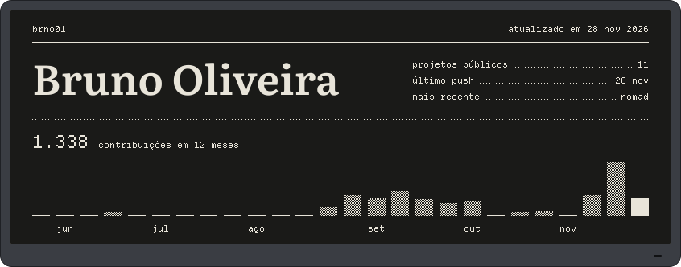
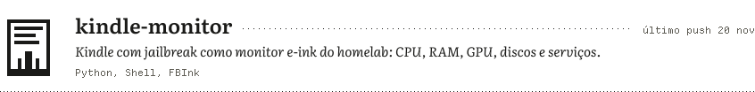
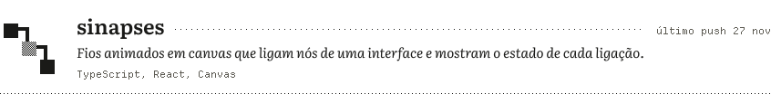

<!-- Arquivo gerado por tools/build.py a partir de tools/content.json. Não edite à mão: edite o JSON e rode `uv run tools/build.py readme`. -->

<picture>
  <source media="(max-width: 767px) and (prefers-color-scheme: dark)" srcset="https://raw.githubusercontent.com/brno01/brno01/output/hero-mobile-dark.svg">
  <source media="(max-width: 767px)" srcset="https://raw.githubusercontent.com/brno01/brno01/output/hero-mobile-light.svg">
  <source media="(prefers-color-scheme: dark)" srcset="https://raw.githubusercontent.com/brno01/brno01/output/hero-desktop-dark.svg">
  
</picture>

Desenvolvedor back-end com foco em automação e infraestrutura: Linux, homelab como código, CI/CD e integrações em Python e TypeScript.

<a href="https://www.linkedin.com/in/brno01oliveira/"><kbd>LinkedIn</kbd></a> <a href="mailto:contato.bruno0dev@gmail.com"><kbd>E-mail</kbd></a> <a href="https://discord.gg/nQEaSHMcnp"><kbd>Discord</kbd></a>

## Sobre

Trabalho com suporte técnico N2 e estou migrando para desenvolvimento. Fora do expediente, mantenho um homelab tratado como produção: tudo versionado, instalado por script, com testes, CI de segurança em cada push e revisão antes do merge.

Gosto de problemas que juntam código e sistema: servidores, redes, automações e as ferramentas que deixam tudo isso fácil de operar.

## Projetos

<a href="https://github.com/brno01/kindle-monitor">
<picture>
  <source media="(max-width: 767px) and (prefers-color-scheme: dark)" srcset="https://raw.githubusercontent.com/brno01/brno01/output/proj-kindle-monitor-mobile-dark.svg">
  <source media="(max-width: 767px)" srcset="https://raw.githubusercontent.com/brno01/brno01/output/proj-kindle-monitor-mobile-light.svg">
  <source media="(prefers-color-scheme: dark)" srcset="https://raw.githubusercontent.com/brno01/brno01/output/proj-kindle-monitor-desktop-dark.svg">
  
</picture>
</a>
<a href="https://github.com/brno01/sinapses">
<picture>
  <source media="(max-width: 767px) and (prefers-color-scheme: dark)" srcset="https://raw.githubusercontent.com/brno01/brno01/output/proj-sinapses-mobile-dark.svg">
  <source media="(max-width: 767px)" srcset="https://raw.githubusercontent.com/brno01/brno01/output/proj-sinapses-mobile-light.svg">
  <source media="(prefers-color-scheme: dark)" srcset="https://raw.githubusercontent.com/brno01/brno01/output/proj-sinapses-desktop-dark.svg">
  
</picture>
</a>
<a href="https://github.com/brno01/tailnet-dns-failover">
<picture>
  <source media="(max-width: 767px) and (prefers-color-scheme: dark)" srcset="https://raw.githubusercontent.com/brno01/brno01/output/proj-tailnet-dns-failover-mobile-dark.svg">
  <source media="(max-width: 767px)" srcset="https://raw.githubusercontent.com/brno01/brno01/output/proj-tailnet-dns-failover-mobile-light.svg">
  <source media="(prefers-color-scheme: dark)" srcset="https://raw.githubusercontent.com/brno01/brno01/output/proj-tailnet-dns-failover-desktop-dark.svg">
  
</picture>
</a>
<a href="https://github.com/brno01/galaxy-s10">
<picture>
  <source media="(max-width: 767px) and (prefers-color-scheme: dark)" srcset="https://raw.githubusercontent.com/brno01/brno01/output/proj-galaxy-s10-mobile-dark.svg">
  <source media="(max-width: 767px)" srcset="https://raw.githubusercontent.com/brno01/brno01/output/proj-galaxy-s10-mobile-light.svg">
  <source media="(prefers-color-scheme: dark)" srcset="https://raw.githubusercontent.com/brno01/brno01/output/proj-galaxy-s10-desktop-dark.svg">
  
</picture>
</a>
<a href="https://github.com/brno01/nomad">
<picture>
  <source media="(max-width: 767px) and (prefers-color-scheme: dark)" srcset="https://raw.githubusercontent.com/brno01/brno01/output/proj-nomad-mobile-dark.svg">
  <source media="(max-width: 767px)" srcset="https://raw.githubusercontent.com/brno01/brno01/output/proj-nomad-mobile-light.svg">
  <source media="(prefers-color-scheme: dark)" srcset="https://raw.githubusercontent.com/brno01/brno01/output/proj-nomad-desktop-dark.svg">
  
</picture>
</a>
<a href="https://github.com/brno01/.github">
<picture>
  <source media="(max-width: 767px) and (prefers-color-scheme: dark)" srcset="https://raw.githubusercontent.com/brno01/brno01/output/proj-dot-github-mobile-dark.svg">
  <source media="(max-width: 767px)" srcset="https://raw.githubusercontent.com/brno01/brno01/output/proj-dot-github-mobile-light.svg">
  <source media="(prefers-color-scheme: dark)" srcset="https://raw.githubusercontent.com/brno01/brno01/output/proj-dot-github-desktop-dark.svg">
  
</picture>
</a>

**Também construí (privados)**

- Homelab como código: contêineres, stack de IA local, servidores de jogo, backups e os scripts que instalam e vigiam tudo.
- App desktop modular em React e Tauri/Rust para ferramentas internas, com autenticação central e execução de integrações auditada.

**Estudos:** [e-Fispq](https://github.com/brno01/e-Fispq) (API em NestJS), [estudo-rest-api-js](https://github.com/brno01/estudo-rest-api-js) (API REST em Express), [app-estudo](https://github.com/brno01/app-estudo) (API REST em Express)

## Stack

**Linguagens** 
<kbd><picture><source media="(prefers-color-scheme: dark)" srcset="https://raw.githubusercontent.com/brno01/brno01/output/stack-python-dark.svg"></picture> Python</kbd> <kbd><picture><source media="(prefers-color-scheme: dark)" srcset="https://raw.githubusercontent.com/brno01/brno01/output/stack-typescript-dark.svg"></picture> TypeScript</kbd> <kbd><picture><source media="(prefers-color-scheme: dark)" srcset="https://raw.githubusercontent.com/brno01/brno01/output/stack-javascript-dark.svg"></picture> JavaScript</kbd> <kbd><picture><source media="(prefers-color-scheme: dark)" srcset="https://raw.githubusercontent.com/brno01/brno01/output/stack-gnubash-dark.svg"></picture> Bash</kbd> <kbd><picture><source media="(prefers-color-scheme: dark)" srcset="https://raw.githubusercontent.com/brno01/brno01/output/stack-rust-dark.svg"></picture> Rust</kbd>

**Back-end** 
<kbd><picture><source media="(prefers-color-scheme: dark)" srcset="https://raw.githubusercontent.com/brno01/brno01/output/stack-nodedotjs-dark.svg"></picture> Node.js</kbd> <kbd><picture><source media="(prefers-color-scheme: dark)" srcset="https://raw.githubusercontent.com/brno01/brno01/output/stack-nestjs-dark.svg"></picture> NestJS</kbd> <kbd><picture><source media="(prefers-color-scheme: dark)" srcset="https://raw.githubusercontent.com/brno01/brno01/output/stack-express-dark.svg"></picture> Express</kbd>

**Infra e ferramentas** 
<kbd><picture><source media="(prefers-color-scheme: dark)" srcset="https://raw.githubusercontent.com/brno01/brno01/output/stack-linux-dark.svg"></picture> Linux</kbd> <kbd><picture><source media="(prefers-color-scheme: dark)" srcset="https://raw.githubusercontent.com/brno01/brno01/output/stack-docker-dark.svg"></picture> Docker</kbd> <kbd><picture><source media="(prefers-color-scheme: dark)" srcset="https://raw.githubusercontent.com/brno01/brno01/output/stack-podman-dark.svg"></picture> Podman</kbd> <kbd><picture><source media="(prefers-color-scheme: dark)" srcset="https://raw.githubusercontent.com/brno01/brno01/output/stack-tailscale-dark.svg"></picture> Tailscale</kbd> <kbd><picture><source media="(prefers-color-scheme: dark)" srcset="https://raw.githubusercontent.com/brno01/brno01/output/stack-githubactions-dark.svg"></picture> GitHub Actions</kbd> <kbd><picture><source media="(prefers-color-scheme: dark)" srcset="https://raw.githubusercontent.com/brno01/brno01/output/stack-git-dark.svg"></picture> Git</kbd> <kbd><picture><source media="(prefers-color-scheme: dark)" srcset="https://raw.githubusercontent.com/brno01/brno01/output/stack-claude-dark.svg"></picture> Claude Code</kbd>

<b>English</b>

### Bruno Oliveira

Back-end developer focused on automation and infrastructure: Linux, homelab as code, CI/CD and integrations in Python and TypeScript.

I work in tier-2 technical support and I am moving into software development. Off the clock I run a homelab the way I would run production: everything versioned, installed by script, tested, security-scanned on every push and reviewed before merging. I enjoy problems where code meets the system: servers, networks, automation and the tools that make all of it easy to operate.

The projects above are the best place to start. Each repository has its own README, CI and security scan.

Este README é gerado: a arte e os números vêm de <a href="tools/build.py">tools/build.py</a> e são refeitos todo dia por uma GitHub Action.

